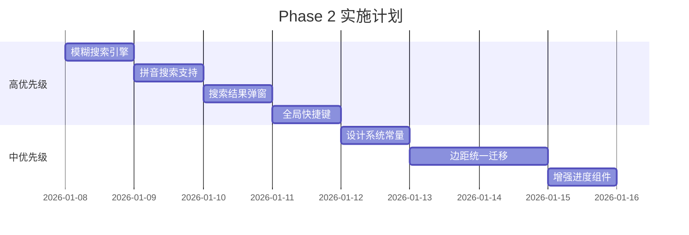

# Phase 2: 体验优化计划

> **开始日期**: 2026-01-08  
> **预期完成**: Phase 1 已完成，进入 Phase 2  
> **状态**: 🚧 进行中

---

## 任务清单

### 2.1 重构搜索功能，支持模糊匹配和拼音搜索 (高优先级)

**当前问题**:
- [`MainWindow.initSearch()`](ui/main_window.py:321) 使用 `QCompleter` 仅支持前缀精确匹配
- 用户输入"压缩"找不到"PDF 压缩"
- 不支持拼音搜索（如输入 "pdf" 或 "hebing" 找不到 "PDF 合并"）

**技术方案**:

```
┌─────────────────────────────────────────────────────────┐
│                    搜索架构改进                          │
├─────────────────────────────────────────────────────────┤
│  用户输入                                                │
│     ↓                                                   │
│  FuzzySearchEngine                                      │
│     ├─ 模糊匹配 (包含匹配)                               │
│     ├─ 拼音匹配 (pypinyin)                              │
│     └─ 权重排序 (名称 > 描述)                            │
│     ↓                                                   │
│  自定义 SearchResultPopup                               │
│     └─ 显示匹配结果列表                                  │
└─────────────────────────────────────────────────────────┘
```

**实现步骤**:

1. **创建搜索引擎模块** `core/utils/fuzzy_search.py`:
   ```python
   class FuzzySearchEngine:
       def __init__(self, items: dict[str, str]):
           # items = {name: description}
           self.items = items
           self._pinyin_cache = {}  # 缓存拼音转换结果
       
       def search(self, query: str, limit: int = 10) -> list[SearchResult]:
           # 1. 空查询返回空
           # 2. 名称包含匹配 (权重 100)
           # 3. 描述包含匹配 (权重 50)
           # 4. 拼音首字母匹配 (权重 80)
           # 5. 拼音全拼匹配 (权重 60)
           # 6. 按权重排序返回
   ```

2. **替换 QCompleter 为自定义弹出窗口**:
   - 继承 `QListWidget` 创建 `SearchResultPopup`
   - 实时显示搜索结果（带图标和描述）
   - 支持键盘导航 (↑↓ Enter Esc)

3. **添加拼音支持**:
   ```python
   # requirements.txt 添加
   pypinyin>=0.51.0
   
   # 使用示例
   from pypinyin import lazy_pinyin, Style
   
   def get_pinyin_initials(text: str) -> str:
       return ''.join([p[0] for p in lazy_pinyin(text)])
   
   def get_pinyin_full(text: str) -> str:
       return ''.join(lazy_pinyin(text))
   ```

**依赖**:
- `pypinyin>=0.51.0` - 拼音转换库

---

### 2.2 添加全局快捷键系统 (高优先级)

**当前问题**:
- 搜索框仅在导航栏展开时可见
- 没有全局快捷键快速触发搜索

**技术方案**:

1. **全局快捷键注册** `Ctrl+K`:
   ```python
   # main_window.py
   from PyQt6.QtGui import QShortcut, QKeySequence
   
   self.search_shortcut = QShortcut(QKeySequence("Ctrl+K"), self)
   self.search_shortcut.activated.connect(self.activate_search)
   
   def activate_search(self):
       # 1. 展开导航栏
       self.navigationInterface.panel.expand()
       # 2. 聚焦搜索框
       self.search_box.setFocus()
       self.search_box.selectAll()
   ```

2. **Esc 键关闭搜索**:
   - 按 Esc 清空搜索框并收起导航栏

---

### 2.3 统一界面边距和间距 (中优先级)

**当前问题**:
- 不同界面使用不同的边距值
  - `pdf_merge_interface.py`: `setContentsMargins(30, 30, 30, 30)`
  - `markdown_interface.py`: `setContentsMargins(20, 20, 20, 20)`
  - 其他界面各不相同

**技术方案**:

1. **创建设计系统常量** `ui/design_system.py`:
   ```python
   class Spacing:
       """统一间距常量"""
       XS = 4
       SM = 8
       MD = 16
       LG = 24
       XL = 32
   
   class Margins:
       """界面边距"""
       PAGE = (24, 24, 24, 24)  # 主页面边距
       CARD = (16, 16, 16, 16)  # 卡片内边距
       SECTION = (0, 16, 0, 16) # 区块间距
   
   class FontSize:
       """字体大小"""
       TITLE = 18
       SUBTITLE = 14
       BODY = 12
       CAPTION = 10
   ```

2. **逐步迁移所有界面**:
   - 优先迁移高频使用的界面
   - 使用常量替换硬编码值

---

### 2.4 改进进度指示 (中优先级)

**当前问题**:
- 进度条只显示数字，没有显示预计剩余时间

**技术方案**:

1. **创建增强进度组件** `ui/widgets/enhanced_progress.py`:
   ```python
   class EnhancedProgressBar(QWidget):
       def __init__(self):
           self.progress_bar = ProgressBar()
           self.status_label = BodyLabel()  # "处理中 (3/10)"
           self.time_label = CaptionLabel() # "约剩余 15 秒"
           
           self._start_time = None
           self._processed_count = 0
       
       def update(self, current: int, total: int, message: str = ""):
           # 1. 更新进度条
           # 2. 计算平均处理时间
           # 3. 估算剩余时间
           elapsed = time.time() - self._start_time
           avg_time = elapsed / current if current > 0 else 0
           remaining = avg_time * (total - current)
           self.time_label.setText(f"约剩余 {int(remaining)} 秒")
   ```

2. **在关键界面集成**:
   - PDF 合并
   - 图片批量转换
   - 批量重命名

---

## 实施顺序



---

## 文件变更清单

### 新增文件
- `core/utils/fuzzy_search.py` - 模糊搜索引擎
- `ui/widgets/search_popup.py` - 搜索结果弹窗
- `ui/design_system.py` - 设计系统常量
- `ui/widgets/enhanced_progress.py` - 增强进度条

### 修改文件
- `ui/main_window.py` - 集成新搜索和快捷键
- `requirements.txt` - 添加 pypinyin 依赖
- 多个 interface 文件 - 迁移到设计系统

---

## 验收标准

### 2.1 模糊搜索
- [ ] 输入"压缩"能匹配到"PDF 压缩"
- [ ] 输入"hebing"能匹配到"PDF 合并" (拼音)
- [ ] 输入"pdf"能匹配所有 PDF 相关功能
- [ ] 结果按相关性排序

### 2.2 全局快捷键
- [ ] Ctrl+K 在任何界面都能激活搜索
- [ ] Esc 能关闭搜索并收起导航栏

### 2.3 设计系统
- [ ] 所有界面边距统一为 24px
- [ ] 卡片内边距统一为 16px

### 2.4 进度指示
- [ ] 批量操作显示预计剩余时间
- [ ] 时间估算误差小于 30%

---

*创建时间: 2026-01-08*