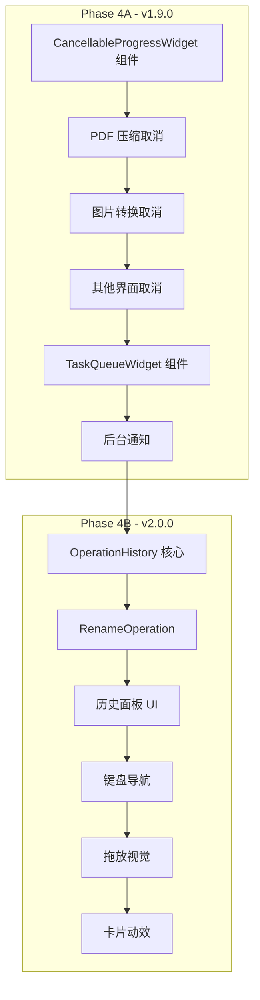

# Phase 4: 功能增强计划

> **计划日期**: 2026-01-08
> **目标版本**: v1.9.0 (Phase 4A) / v2.0.0 (Phase 4B)
> **基于**: [产品审计报告](product_audit_report.md) Phase 4 章节
> **状态**: 📋 技术分析完成，准备实施

---

## 📊 Phase 4 概述

Phase 4 是产品审计的最后阶段，专注于**增强功能**和**交互优化**。根据审计报告的原始定义和当前项目状态，我们将 Phase 4 拆分为两个子阶段：

| 子阶段 | 目标版本 | 核心主题 | 状态 |
|--------|----------|----------|------|
| Phase 4A | v1.9.0 | 任务控制增强 | 🔄 进行中 |
| Phase 4B | v2.0.0 | 交互体验增强 | 📋 待开始 |

### 原审计报告 Phase 4 项目状态

| 原计划项目 | 当前状态 | 说明 |
|-----------|----------|------|
| 实现拼音搜索 | ✅ 已完成 | v1.7.0 在 `core/utils/fuzzy_search.py` 实现 |
| 支持任务队列和取消操作 | ⚠️ 部分完成 | v1.8.0 `WorkerThread.cancel()` 已实现，UI 按钮未添加 |
| 添加操作历史和撤销功能 | ❌ 未开始 | 计划在 Phase 4B 实现 |
| 添加键盘导航完整支持 | ❌ 未开始 | 计划在 Phase 4B 实现 |

---

## 🎯 Phase 4A: 任务控制增强 (v1.9.0)

### 目标
让用户对长时间运行的任务有更好的**可见性**和**控制能力**。

### 4A.1 任务取消按钮 ⭐ 高优先级

#### 问题描述
当前所有耗时操作（PDF 压缩、批量转换、图片处理等）没有取消按钮，用户只能等待完成或强制关闭应用。这违反了 Nielsen 启发式原则 #3：**用户控制与自由**。

#### 需要添加取消功能的界面

| 界面文件 | 功能 | 线程类 | 优先级 |
|---------|------|--------|--------|
| `pdf_compress_interface.py` | PDF 压缩 | `CompressThread` | 高 |
| `image_convert_interface.py` | 图片格式转换 | `QThreadPool` + `ConvertTask` | 高 |
| `pdf_render_interface.py` | PDF 转图片 | `PDFRenderThread` | 高 |
| `pdf_merge_interface.py` | PDF 合并 | `MergeThread` | 中 |
| `pdf_split_interface.py` | PDF 拆分 | `PDFSplitThread` | 中 |
| `txt_pdf_interface.py` | TXT 转 PDF | `TxtPdfThread` | 中 |
| `markdown_interface.py` | Markdown 导出 | 内联线程 | 中 |
| `batch_rename_interface.py` | 批量重命名 | 同步执行 | 低 |
| `doc_to_docx_interface.py` | Doc 转 Docx | `DocToDocxThread` | 低 |
| `ppt_image_interface.py` | PPT 导出图片 | `PPTImageExportThread` | 低 |

#### 现有代码分析

经过对项目代码的详细分析，以下是各界面的当前状态和改造难度：

| 界面 | 进度条类型 | 线程类型 | 取消支持难度 | 说明 |
|------|-----------|---------|-------------|------|
| `pdf_compress_interface.py` | `EnhancedProgressBar` | `CompressThread` | 🟢 低 | 使用独立线程，可直接添加取消标志 |
| `image_convert_interface.py` | `EnhancedProgressBar` | `QThreadPool` + `ConvertTask` | 🟡 中 | 需要实现 `QThreadPool` 任务取消 |
| `pdf_render_interface.py` | 仅按钮文本 | `PDFRenderThread` | 🟢 低 | 需要先添加进度条组件 |
| `pdf_merge_interface.py` | `EnhancedProgressBar` | `MergeThread` | 🟢 低 | 通常较快，优先级较低 |
| `pdf_split_interface.py` | `EnhancedProgressBar` | `PDFSplitThread` | 🟢 低 | 通常较快，优先级较低 |

**关键发现:**
1. 所有界面都已使用 `EnhancedProgressBar`（除了 `pdf_render_interface.py` 只更新按钮文本）
2. `WorkerThread` 类已有 `cancel()` 方法，但遗留线程类没有
3. `image_convert_interface.py` 使用 `QThreadPool`，需要特殊处理

#### 技术方案

**方案 A: 创建可复用的 CancellableProgressWidget 组件** (推荐)

```python
# ui/widgets/cancellable_progress.py

from PyQt6.QtWidgets import QWidget, QHBoxLayout, QPushButton, QProgressBar
from PyQt6.QtCore import pyqtSignal
from qfluentwidgets import ProgressBar, PushButton, FluentIcon

class CancellableProgressWidget(QWidget):
    """
    带取消按钮的进度条组件
    
    使用示例:
    ```python
    self.progress_widget = CancellableProgressWidget()
    self.progress_widget.cancel_clicked.connect(self.on_cancel)
    self.progress_widget.set_progress(50, 100, "处理中...")
    ```
    """
    cancel_clicked = pyqtSignal()
    
    def __init__(self, parent=None, show_eta=True):
        super().__init__(parent)
        self.show_eta = show_eta
        self._is_cancelled = False
        self._setup_ui()
    
    def _setup_ui(self):
        layout = QHBoxLayout(self)
        layout.setContentsMargins(0, 0, 0, 0)
        
        # 进度条（使用 EnhancedProgressBar 如果需要 ETA）
        if self.show_eta:
            from ui.widgets.enhanced_progress import EnhancedProgressBar
            self.progress_bar = EnhancedProgressBar()
        else:
            self.progress_bar = ProgressBar()
        
        # 取消按钮
        self.cancel_btn = PushButton("取消")
        self.cancel_btn.setIcon(FluentIcon.CLOSE)
        self.cancel_btn.setFixedWidth(80)
        self.cancel_btn.clicked.connect(self._on_cancel_clicked)
        
        layout.addWidget(self.progress_bar, 1)
        layout.addWidget(self.cancel_btn)
    
    def _on_cancel_clicked(self):
        self._is_cancelled = True
        self.cancel_btn.setEnabled(False)
        self.cancel_btn.setText("取消中...")
        self.cancel_clicked.emit()
    
    def set_progress(self, current: int, total: int, message: str = ""):
        """更新进度"""
        if hasattr(self.progress_bar, 'update_progress'):
            self.progress_bar.update_progress(current, total, message)
        else:
            self.progress_bar.setValue(int(current / total * 100))
    
    def reset(self):
        """重置状态"""
        self._is_cancelled = False
        self.cancel_btn.setEnabled(True)
        self.cancel_btn.setText("取消")
        if hasattr(self.progress_bar, 'reset'):
            self.progress_bar.reset()
        else:
            self.progress_bar.setValue(0)
    
    def set_complete(self, success: bool = True):
        """设置完成状态"""
        self.cancel_btn.setEnabled(False)
        if self._is_cancelled:
            self.cancel_btn.setText("已取消")
        elif success:
            self.cancel_btn.setText("完成")
        else:
            self.cancel_btn.setText("失败")
    
    @property
    def is_cancelled(self) -> bool:
        return self._is_cancelled
```

**方案 B: 直接在各界面添加取消按钮**

适用于界面逻辑简单或无法统一的情况。

#### 实现步骤

**Step 1: 增强遗留线程类** (`ui/threads.py`)
- 为所有遗留线程类添加 `_is_cancelled` 标志和 `cancel()` 方法
- 修改 `run()` 方法检查取消状态

```python
# 示例: CompressThread 改造
class CompressThread(QThread):
    def __init__(self, compressor, files, quality, gs_path):
        super().__init__()
        self.compressor = compressor
        self.files = files
        self.quality = quality
        self.gs_path = gs_path
        self._is_cancelled = False  # 新增
    
    def cancel(self):  # 新增
        self._is_cancelled = True
        
    def run(self):
        if not self._is_cancelled:  # 新增检查
            self.compressor.compress(self.files, self.quality, gs_path=self.gs_path)
```

**Step 2: 创建 CancellableProgressWidget 组件** (`ui/widgets/cancellable_progress.py`)
- 封装 `EnhancedProgressBar` + 取消按钮
- 提供统一的 API

**Step 3: 修改 PDF 压缩界面** (`ui/interfaces/pdf/pdf_compress_interface.py`)
- 替换 `EnhancedProgressBar` 为 `CancellableProgressWidget`
- 连接 `cancel_clicked` 信号
- 修改 `on_finished` 处理取消状态

**Step 4: 修改图片转换界面** (`ui/interfaces/image/image_convert_interface.py`)
- 添加 `_is_cancelling` 标志
- 实现 `cancel_all_tasks()` 方法
- 清除 `QThreadPool` 中的等待任务

```python
def cancel_all_tasks(self):
    self._is_cancelling = True
    self.thread_pool.clear()  # 清除队列中未执行的任务
    # 正在执行的任务会在下次检查时发现取消标志
```

**Step 5: 依次改造其他界面**
- `pdf_render_interface.py`
- `pdf_merge_interface.py`
- `pdf_split_interface.py`

#### 验收标准

- [ ] 所有高优先级界面都有取消按钮
- [ ] 点击取消后，正在执行的任务能够停止
- [ ] 取消后显示"已取消"状态，而非错误状态
- [ ] 取消操作不会导致文件损坏或数据丢失

---

### 4A.2 任务队列管理 ⭐ 中优先级

#### 问题描述
当前批量操作（如批量图片转换）只显示总进度，无法看到单个任务的状态。用户无法知道哪个文件正在处理、哪个失败了。

#### 技术方案

创建 `TaskQueueWidget` 组件：

```python
# ui/widgets/task_queue.py

class TaskItem(NamedTuple):
    id: str
    name: str
    status: str  # 'pending', 'running', 'completed', 'failed', 'cancelled'
    progress: int  # 0-100
    error: Optional[str]

class TaskQueueWidget(QWidget):
    """
    任务队列显示组件
    
    显示任务列表和各自的状态：
    - ⏳ 待处理
    - 🔄 处理中 (带进度)
    - ✅ 已完成
    - ❌ 失败 (显示错误原因)
    - 🚫 已跳过
    """
    
    def __init__(self, parent=None):
        super().__init__(parent)
        self._tasks: Dict[str, TaskItem] = {}
        self._setup_ui()
    
    def add_task(self, task_id: str, name: str):
        """添加任务到队列"""
        pass
    
    def update_task(self, task_id: str, status: str, progress: int = 0, error: str = None):
        """更新任务状态"""
        pass
    
    def get_summary(self) -> Dict[str, int]:
        """获取统计摘要 {completed: 5, failed: 1, pending: 3}"""
        pass
```

#### 应用场景

| 界面 | 当前状态 | 改进后 |
|------|---------|--------|
| 图片批量转换 | 只显示 "3/10 完成" | 显示每个文件的转换状态 |
| PDF 批量处理 | 只显示总进度 | 显示每个 PDF 的处理状态 |
| 批量重命名 | 预览表格 + 最终结果 | 实时更新每个文件的重命名状态 |

#### 实现步骤

1. 创建 `TaskQueueWidget` 组件
2. 在图片转换界面集成
3. 在其他批量操作界面集成

---

### 4A.3 后台任务通知 ⭐ 低优先级

#### 问题描述
长时间运行的任务（如压缩大型 PDF）完成后，如果用户切换到其他应用，无法得知任务已完成。

#### 技术方案

```python
# core/utils/notification.py

import platform

def send_notification(title: str, message: str, icon_path: str = None):
    """
    发送系统通知
    
    Windows: 使用 win10toast 或 plyer
    macOS: 使用 pync 或 osascript
    Linux: 使用 notify-send
    """
    system = platform.system()
    
    if system == "Windows":
        try:
            from win10toast import ToastNotifier
            toaster = ToastNotifier()
            toaster.show_toast(title, message, icon_path=icon_path, duration=5)
        except ImportError:
            pass  # 静默降级
    elif system == "Darwin":
        import subprocess
        subprocess.run(['osascript', '-e', f'display notification "{message}" with title "{title}"'])
    else:
        import subprocess
        subprocess.run(['notify-send', title, message])
```

#### 触发时机
- 任务执行时间超过 10 秒
- 任务完成时应用窗口不在前台

---

## 🎨 Phase 4B: 交互增强 (v2.0.0)

### 4B.1 操作历史与撤销系统 ⭐ 高优先级

#### 问题描述
完成批量操作（如重命名、转换）后没有操作记录，用户无法查看历史或撤销误操作。

#### 技术架构

```
┌─────────────────────────────────────────────────────┐
│                  OperationHistory                    │
├─────────────────────────────────────────────────────┤
│  - operations: List[Operation]                       │
│  - max_history: int = 50                             │
│  - current_index: int                                │
├─────────────────────────────────────────────────────┤
│  + record(operation: Operation)                      │
│  + undo() -> bool                                    │
│  + redo() -> bool                                    │
│  + get_history() -> List[OperationSummary]          │
│  + clear()                                           │
└─────────────────────────────────────────────────────┘
                         │
                         ▼
┌─────────────────────────────────────────────────────┐
│                    Operation                         │
├─────────────────────────────────────────────────────┤
│  <<abstract>>                                        │
│  + execute() -> bool                                 │
│  + undo() -> bool                                    │
│  + get_summary() -> OperationSummary                │
└─────────────────────────────────────────────────────┘
          △                           △
          │                           │
┌─────────────────────┐   ┌─────────────────────────┐
│  RenameOperation    │   │  FileDeleteOperation    │
├─────────────────────┤   ├─────────────────────────┤
│  - old_paths: List  │   │  - deleted_files: List  │
│  - new_paths: List  │   │  - backup_dir: Path     │
└─────────────────────┘   └─────────────────────────┘
```

#### 支持的可撤销操作

| 操作类型 | 撤销方式 | 复杂度 |
|---------|---------|--------|
| 批量重命名 | 记录旧名→新名映射，执行反向重命名 | 低 |
| 文件删除 | 移动到回收站/备份目录，而非直接删除 | 中 |
| 文件移动 | 记录原位置，执行反向移动 | 中 |

#### 界面设计

1. **快捷键支持**: `Ctrl+Z` 撤销, `Ctrl+Shift+Z` 重做
2. **历史面板**: 可选的侧边栏，显示最近 50 条操作
3. **操作提示**: 完成操作后显示 "已完成，按 Ctrl+Z 撤销"

---

### 4B.2 键盘导航完善 ⭐ 高优先级

#### 问题描述
分类首页的功能卡片不支持键盘方向键导航和 Enter 键选择。

#### 改进方案

**分类首页卡片导航** (`ui/widgets/category_home.py`):

```python
def keyPressEvent(self, event):
    if event.key() == Qt.Key.Key_Right:
        self._select_next_card()
    elif event.key() == Qt.Key.Key_Left:
        self._select_prev_card()
    elif event.key() == Qt.Key.Key_Down:
        self._select_card_below()
    elif event.key() == Qt.Key.Key_Up:
        self._select_card_above()
    elif event.key() == Qt.Key.Key_Return:
        self._activate_selected_card()
    elif event.key() == Qt.Key.Key_Home:
        self._select_first_card()
    elif event.key() == Qt.Key.Key_End:
        self._select_last_card()
```

**搜索结果导航** (已部分支持 ↑↓):
- 添加 `Home` 跳转到第一个结果
- 添加 `End` 跳转到最后一个结果
- 添加 `Escape` 关闭搜索

---

### 4B.3 拖放区域视觉增强 ⭐ 中优先级

#### 问题描述
`DragDropListWidget` 拖放进入时没有明显的视觉变化。

#### 改进方案

```python
# ui/widgets/drag_drop_list.py

def dragEnterEvent(self, event):
    if self._is_valid_drop(event):
        event.acceptProposedAction()
        # 添加视觉反馈
        self.setStyleSheet("""
            DragDropListWidget {
                border: 2px dashed #0078d4;
                background-color: rgba(0, 120, 212, 0.1);
            }
        """)
        # 显示提示文字
        self._show_drop_hint("释放以添加文件")

def dragLeaveEvent(self, event):
    # 恢复原样式
    self.setStyleSheet("")
    self._hide_drop_hint()

def dropEvent(self, event):
    self.setStyleSheet("")
    self._hide_drop_hint()
    # ... 处理文件
```

---

### 4B.4 卡片悬浮动效 ⭐ 低优先级

#### 问题描述
`FeatureCard` 悬浮时只改变阴影效果，视觉反馈过于微妙。

#### 改进方案

```python
# ui/widgets/feature_card.py

def enterEvent(self, event):
    # 原有阴影效果
    self._update_shadow(hovered=True)
    
    # 新增：上浮动画
    self._float_animation = QPropertyAnimation(self, b"pos")
    self._float_animation.setDuration(150)
    self._float_animation.setStartValue(self.pos())
    self._float_animation.setEndValue(self.pos() - QPoint(0, 3))
    self._float_animation.setEasingCurve(QEasingCurve.Type.OutCubic)
    self._float_animation.start()
    
    # 新增：边框高亮
    self.setStyleSheet("FeatureCard { border: 1px solid rgba(0, 120, 212, 0.3); }")

def leaveEvent(self, event):
    self._update_shadow(hovered=False)
    
    # 恢复位置
    self._float_animation = QPropertyAnimation(self, b"pos")
    self._float_animation.setDuration(150)
    self._float_animation.setStartValue(self.pos())
    self._float_animation.setEndValue(self.pos() + QPoint(0, 3))
    self._float_animation.start()
    
    self.setStyleSheet("")
```

---

## 📋 Phase 3 延后项

以下项目从 Phase 3 延后，可考虑在 Phase 4 后期或 Phase 5 实现：

### 延后项 1: Markdown 工具合并

**问题**: `MarkdownInterface` 和 `MarkdownPdfBatchInterface` 功能重叠

**方案**: 
- 合并为单一界面
- 支持单文件/批量模式切换
- 统一的导出选项

### 延后项 2: 统一接口初始化协议

**问题**: 部分界面通过 `container` 参数获取依赖，部分直接调用 `AppContainer()`

**方案**:
- 所有界面统一接受 `container` 参数
- 在 `lazy_loader.py` 中统一注入

---

## ⏱️ 时间估算

| 阶段 | 内容 | 预计工作量 |
|------|------|-----------|
| Phase 4A.1 | 任务取消按钮 | 2-3 天 |
| Phase 4A.2 | 任务队列管理 | 2-3 天 |
| Phase 4A.3 | 后台任务通知 | 0.5 天 |
| Phase 4B.1 | 操作历史系统 | 3-4 天 |
| Phase 4B.2 | 键盘导航 | 1-2 天 |
| Phase 4B.3 | 拖放视觉增强 | 0.5 天 |
| Phase 4B.4 | 卡片动效 | 0.5 天 |

---

## 🔄 实施顺序



---

## ✅ 验收清单

### Phase 4A (v1.9.0)
- [ ] 所有耗时操作界面都有取消按钮
- [ ] 取消操作正常工作，不会导致数据损坏
- [ ] 批量操作显示任务队列状态
- [ ] 长时间任务完成后有系统通知

### Phase 4B (v2.0.0)
- [ ] 批量重命名支持撤销
- [ ] Ctrl+Z 快捷键可用
- [ ] 分类首页支持键盘导航
- [ ] 拖放区域有明显的视觉反馈
- [ ] 功能卡片悬浮有动画效果

---

*计划生成时间: 2026-01-08T15:44:00Z*